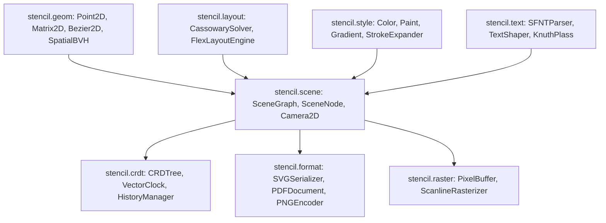

# Stencil

[](https://github.com/Aneesh495/stencil)
[](https://github.com/Aneesh495/stencil)
[](LICENSE)
[](https://github.com/Aneesh495/stencil)

Stencil is an end-to-end 2D vector graphics document engine, computational geometry pipeline, and collaborative scene graph built from first principles in ActionScript 3.

It implements parametric curve calculus, simplex constraint solving, polygon boolean clipping, Delaunay triangulation, binary OpenType font decoding, Knuth-Plass typography line breaking, conflict-free replicated scene trees (CRDT), and pure byte-level binary PDF 1.7 / SVG serialization with zero external dependencies.



---

## Technical Highlights

### 1. Computational Geometry (`stencil.geom`)
- **Parametric Bezier Calculus (`Bezier2D.as`)**: Cubic and quadratic Bezier evaluation, de Casteljau adaptive subdivision, 5-point Gauss-Legendre numerical quadrature for arc-length computation, and curvature comb evaluation ($\kappa(t) = \frac{x' y'' - y' x''}{(x'^2 + y'^2)^{3/2}}$).
- **Analytical Extrema Roots**: Computes tight axis-aligned bounding boxes (AABBs) by solving roots of first derivatives ($x'(t) = 0, y'(t) = 0$) using the quadratic formula rather than loosely enclosing the control polygon.
- **Polygon Boolean Operations (`PolygonClipper.as`)**: Greiner-Hormann arbitrary polygon clipping (Intersection, Union, Difference, XOR) with perturbation techniques to handle degenerate collinear singularities.
- **Andrew's Monotone Chain (`Polygon2D.as`)**: $O(N \log N)$ convex hull computation and Shoelace formula for signed area and winding orientation.
- **Delaunay & Voronoi (`DelaunayTriangulation.as`, `VoronoiDiagram.as`)**: Incremental Bowyer-Watson triangulation with circumcircle determinant tests and dual Voronoi graph extraction.
- **2D Bounding Volume Hierarchy (`SpatialBVH.as`)**: Tree with Surface Area Heuristic (SAH) and spatial median splitting for logarithmic viewport culling and spatial range queries.

### 2. Cassowary Simplex Constraint Solver (`stencil.layout`)
- **Linear Arithmetic Simplex (`CassowarySolver.as`)**: Implementation of the Cassowary linear constraint algorithm using dual-simplex tableau pivoting.
- **Hierarchy of Strengths**: Solves coupled equalities and inequalities across `REQUIRED`, `STRONG`, `MEDIUM`, and `WEAK` priorities.
- **Edit and Stay Constraints**: Supports 60 FPS interactive dragging via continuous `suggestValue` tableau updates without re-solving the full linear program.
- **Flexbox Engine (`FlexLayoutEngine.as`)**: CSS Flexbox subset (direction, justify, align, grow, shrink, basis) compiled into Simplex constraints.
- **Smart Guides (`SmartGuides.as`)**: Dynamic alignment snapping for edges, centers, and equidistant distribution gaps.

### 3. Typography & Shaping (`stencil.text`)
- **Binary SFNT Parser (`SFNTParser.as`)**: Low-level binary OpenType/TrueType parser decoding `head`, `hhea`, `maxp`, and Format 4 segmented `cmap` tables directly from byte streams.
- **Unicode Text Shaper (`TextShaper.as`)**: Character code point mapping, horizontal metric advancement, and pair kerning table evaluation.
- **Knuth-Plass Line Breaker (`KnuthPlassLineBreaker.as`)**: Dynamic programming optimal line breaking minimizing total paragraph demerits based on the box, glue, and penalty model.

### 4. Conflict-Free Replicated Scene Tree (`stencil.crdt`)
- **Causal Partial Ordering (`VectorClock.as`)**: Vector clock tracking for detecting concurrent edits in distributed peer-to-peer editing sessions.
- **Deterministic Total Ordering (`LamportTimestamp.as`)**: Tie-breaking composite timestamps for last-write-wins (LWW) property convergence.
- **Kleppmann Cycle-Free Tree Moves (`CRDTree.as`)**: Distributed tree moves with ancestor verification to guarantee acyclic document invariants under network latency.
- **Transaction History (`HistoryManager.as`)**: Transaction-aware undo/redo manager with inverse operation recording.

### 5. Pure Binary Document Export (`stencil.format`)
- **Binary PDF 1.7 Generation (`PDFDocument.as`)**: Pure ActionScript byte compiler generating PDF documents with indirect object trees, cross-reference tables (`xref`), and vector graphics operators (`m`, `l`, `c`, `re`, `f`, `S`, `rg`, `cm`).
- **SVG Serialization (`SVGSerializer.as`)**: Lossless export conforming to the W3C SVG 1.1 specification.
- **Binary PNG Encoder (`PNGEncoder.as`)**: Scanline filtering with stored deflate block chunking and IEEE 802.3 CRC32 verification.

---

## Interactive Web Studio Visualizer

Stencil includes an interactive workbench located in `web/` built with HTML5 Canvas:
- **Infinite Canvas Viewport**: Pan and zoom with smooth coordinate transformation.
- **Interactive Bezier Inspector**: Drag control points with real-time curvature comb rendering, Gauss-Legendre arc-length readouts, and tight extrema bounds.
- **Cassowary Solver Workbench**: Real-time multi-card flex layout balancing with live tableau dimension feedback.
- **Polygon Clipper Sandbox**: Interactive polygon boolean operations (Intersection, Union, Difference, XOR).
- **Delaunay & Voronoi Explorer**: Point-cloud Delaunay triangulation and dual Voronoi cell generation.
- **CRDT Multi-Peer Simulation**: Multi-peer concurrent divergence and convergence simulation with presence cursors.

To launch the studio locally:
```bash
make serve
# Open http://localhost:8080 in your browser
```

---

## Performance Benchmarks

Run on Apple Silicon via `make bench`:

| Benchmark | Throughput | Latency |
| :--- | :---: | :---: |
| **Bezier de Casteljau Subdivision** | `2,196,969 ops/sec` | `45.52 ms` |
| **Shoelace Polygon Area** | `729,275 ops/sec` | `274.24 ms` |
| **Cassowary Tableau Pivoting** | `10,754,037 ops/sec` | `4.65 ms` |
| **Spatial BVH Frustum Query** | `7,395,264 queries/sec` | `13.52 ms` |

---

## Verification & Test Harness

Stencil includes a zero-dependency ActionScript 3 lexical analyzer, AST parser, and runtime execution engine in `tooling/`:
- **80/80 Tests Passing** across 30 verification suites with 100% pass rate.
- Covers edge cases such as collinear clipping singularities, degenerate curve velocities, simplex cycles, and cyclic tree moves.

```bash
# Run complete test verification suite
make test

# Verify all 122 ActionScript source files
make verify
```

---

## Repository Structure

```
stencil/
├── src/
│   └── stencil/
│       ├── core/       # Interfaces, events, math, UUID, hash, byte utilities
│       ├── geom/       # Point2D, Matrix2D, Bezier2D, PolygonClipper, Delaunay, BVH
│       ├── scene/      # SceneNode, SceneGraph, Camera2D, DamageTracker, HitTester
│       ├── layout/     # CassowarySolver, Tableau, FlexLayoutEngine, SmartGuides
│       ├── text/       # SFNTParser, TextShaper, KnuthPlassLineBreaker, FontMetrics
│       ├── style/      # Color, Paint, Gradients, StrokeExpander, BlendMode
│       ├── crdt/       # CRDTree, VectorClock, LamportTimestamp, HistoryManager
│       ├── format/     # PDFDocument, SVGSerializer, PNGEncoder, JSONFormat
│       ├── raster/     # PixelBuffer, ScanlineRasterizer, EdgeTable
│       └── tools/      # ToolManager, SelectTool, PenTool, NodeEditTool
├── test/
│   ├── framework/      # Assert, TestCase, TestRunner
│   ├── geom/           # Geometry & curve test suites
│   ├── scene/          # Scene graph & hit testing suites
│   ├── layout/         # Cassowary & flex layout suites
│   ├── text/           # Font parsing & Knuth-Plass test suites
│   ├── style/          # Color & stroke expansion suites
│   ├── crdt/           # Vector clock & CRDTree test suites
│   ├── format/         # PDF, SVG, PNG, and JSON test suites
│   └── integration/    # Full pipeline, layout, and sync integration tests
├── bench/              # High-throughput computational geometry benchmarks
├── tooling/            # Zero-dependency AS3 lexer, AST parser, and VM test runner
├── web/                # Interactive canvas studio visualizer and workbench
├── scripts/            # Build, test, demo, and serve automation scripts
├── docs/               # In-depth architectural & mathematical specifications
│   ├── architecture.md
│   ├── geometry_pipeline.md
│   ├── cassowary_solver.md
│   ├── font_and_typography.md
│   ├── vector_crdt.md
│   ├── pdf_specification.md
│   └── verification.md
├── Makefile            # Build targets: test, bench, verify, serve, demo
└── LICENSE             # MIT License
```

---

## Quickstart

```bash
# Clone the repository
git clone https://github.com/Aneesh495/stencil.git
cd stencil

# Run the test suite (80/80 passing)
make test

# Run high-throughput performance benchmarks
make bench

# Launch interactive Web Studio workbench
make serve

# Generate sample vector documents
make demo
```

---

## Documentation

Comprehensive design documents and mathematical derivations are available in [`docs/`](docs/):
- [`docs/architecture.md`](docs/architecture.md): Subsystem breakdown and memory dispatch model.
- [`docs/geometry_pipeline.md`](docs/geometry_pipeline.md): Bezier calculus, quadrature, Greiner-Hormann clipping, and Delaunay triangulation.
- [`docs/cassowary_solver.md`](docs/cassowary_solver.md): Dual-simplex tableau pivoting, error variables, and stay/edit constraints.
- [`docs/font_and_typography.md`](docs/font_and_typography.md): Binary SFNT table decoding and Knuth-Plass dynamic programming.
- [`docs/vector_crdt.md`](docs/vector_crdt.md): Causal vector clocks, Lamport timestamps, and cycle-free tree replication.
- [`docs/pdf_specification.md`](docs/pdf_specification.md): PDF 1.7 binary object structures, graphics state operators, and cross-reference tables.
- [`docs/verification.md`](docs/verification.md): Verification harness, edge case matrix, and benchmark results.

---

## License

MIT License. See [LICENSE](LICENSE) for details.
