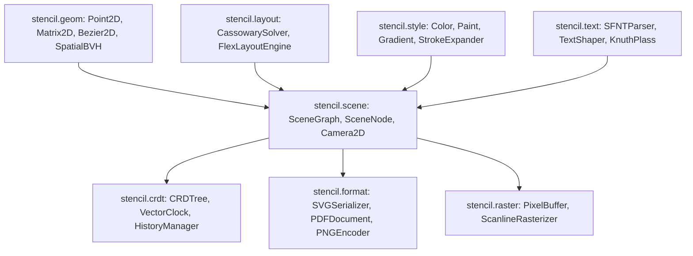

# Stencil Architecture Specification

Stencil is a high-performance vector graphics document engine and computational geometry pipeline written in ActionScript 3. The engine provides an end-to-end stack for interactive 2D graphics: parametric curve calculus, simplex constraint solving, spatial partitioning, typography shaping, collaborative tree CRDTs, and direct-to-binary document export (SVG, PDF 1.7, and PNG).

## Layered Subsystems

The codebase is organized into eight decoupled, modular packages:

### 1. `stencil.core`
The foundational runtime layer providing memory lifecycle management, event dispatching, and hashing utilities:
- `IDisposable`, `ICloneable`, `ISerializable`: Explicit lifecycle interfaces to eliminate memory leaks and dangling closures.
- `EventEmitter`: Fast, low-overhead typed event distribution without overhead from dynamic Flash display list dispatch.
- `MathUtil`: Numerical stability primitives, clamping, epsilon comparisons, and angle conversions.
- `UUID` & `HashUtil`: RFC 4122 v4 unique identifier generation and FNV-1a / Pearson hashing for dirty state tracking.

### 2. `stencil.geom`
Hardware-independent computational geometry engine:
- `Matrix2D`: 3x3 affine transformation matrix with determinant evaluation, adjoint inversion, QR decomposition, and shear support.
- `Bezier2D`: Quadratic and cubic Bezier curve evaluation, de Casteljau recursive subdivision, 5-point Gauss-Legendre quadrature arc-length computation, curvature calculus, and extrema root finding for tight axis-aligned bounding boxes (AABBs).
- `Polygon2D` & `PolygonClipper`: Shoelace formula for area and orientation, Andrew's monotone chain convex hull, and Greiner-Hormann arbitrary polygon boolean operations (intersection, union, difference, and XOR).
- `DelaunayTriangulation` & `VoronoiDiagram`: Incremental Bowyer-Watson Delaunay triangulation with circumcircle tests, and dual Voronoi graph extraction.
- `SpatialBVH`: 2D bounding volume hierarchy using surface area heuristic (SAH) and spatial median splitting for logarithmic viewport culling and spatial range queries.

### 3. `stencil.scene`
Retained-mode directed acyclic graph (DAG) representing the document hierarchy:
- `SceneNode`: Hierarchical tree node featuring cached local and global transforms, dirty flag propagation, opacity cascading, and bounding box unions.
- `SceneGraph`: Root container managing the SpatialBVH spatial index, camera coordinate mappings, and depth traversals.
- `Camera2D`: Infinite canvas viewport with smooth translation, anchored focal zooming, and inverted projection matrices.
- `DamageTracker`: Coalesced dirty rectangle accumulation to minimize redraw overhead during interactive editing.
- `HitTester`: Geometric point-in-fill and point-to-stroke proximity testing for interactive selection.

### 4. `stencil.layout`
Simplex-based constraint solving and responsive flexbox layout:
- `CassowarySolver`: Linear arithmetic constraint solver implementing the dual-simplex algorithm with sparse tableau pivoting, stay constraints, and edit constraints.
- `FlexLayoutEngine`: CSS Flexbox subset supporting flex-direction (row/column), justify-content, align-items, flex-grow, flex-shrink, and flex-basis.
- `SmartGuides`: Dynamic snap alignment detecting edge alignment, center alignment, and equidistant distribution gaps between visual elements.

### 5. `stencil.text`
Binary font parsing, text shaping, and optimal paragraph line breaking:
- `SFNTParser`: Binary OpenType/TrueType parser decoding `head`, `hhea`, `maxp`, and Format 4 `cmap` tables directly from byte streams.
- `FontMetrics`: Typographic ascent, descent, line gap, and bounding box metadata.
- `TextShaper`: Horizontal glyph advancement, whitespace normalization, and pair kerning extraction.
- `KnuthPlassLineBreaker`: Dynamic programming line breaking minimizing total demerits across paragraphs using boxes, glues, and penalties.

### 6. `stencil.style`
Rendering attributes and compositing definitions:
- `Color`: 32-bit ARGB packed integer manipulation with conversions to/from RGBA, HSL, and HSV, plus WCAG 2.1 relative luminance and contrast ratio calculations.
- `Paint`: Solid color, linear gradient, radial gradient, and conic sweep gradient fills with configurable spread modes (pad, reflect, repeat).
- `StrokeStyle` & `StrokeExpander`: Arbitrary vector stroke widening into dual parallel offset paths with round, bevel, and miter joins.

### 7. `stencil.crdt`
Conflict-free replicated data types for peer-to-peer real-time collaboration:
- `VectorClock`: Causal ordering and concurrency detection across arbitrary distributed peers.
- `LamportTimestamp`: Deterministic tie-breaking for concurrent property mutations.
- `CRDTree`: Replicated scene hierarchy implementing Martin Kleppmann's cycle-prevention algorithm and tombstone deletion.
- `HistoryManager`: Reversible transaction manager with undo/redo stacks.

### 8. `stencil.format`
Direct serialization to standard industry vector formats:
- `SVGParser` & `SVGSerializer`: Path token parsing and lossless W3C SVG document generation.
- `PDFDocument`: Pure ActionScript binary PDF 1.7 writer with cross-reference tables, indirect object dictionary streams, vector drawing operators (`m`, `l`, `c`, `re`, `f`, `s`), and font resource dictionaries.
- `JSONFormat`: Lossless JSON schema serialization and deserialization.
- `PNGEncoder`: Direct 32-bit ARGB raster-to-PNG chunk generation with IEEE 802.3 CRC32 checksums.
